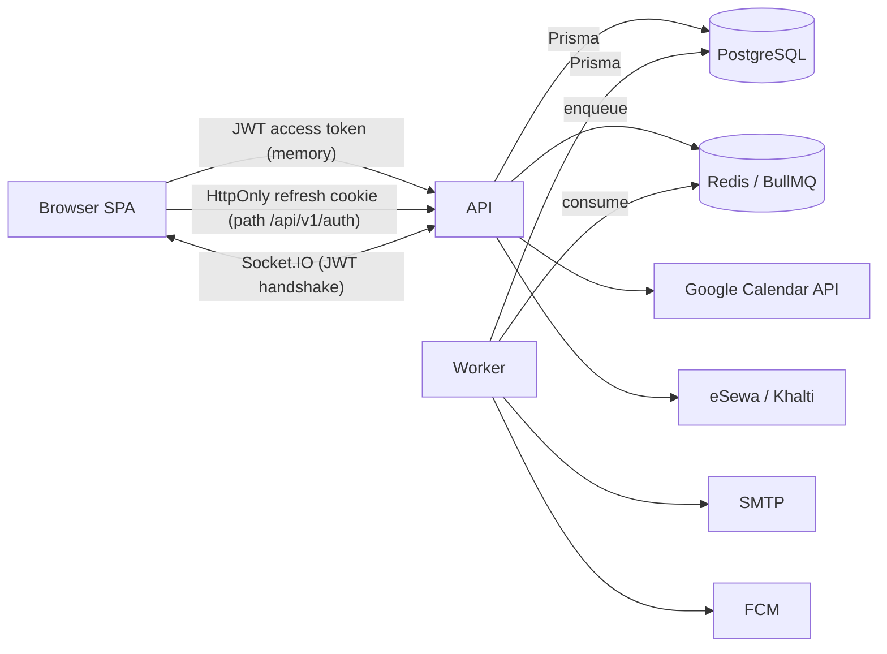
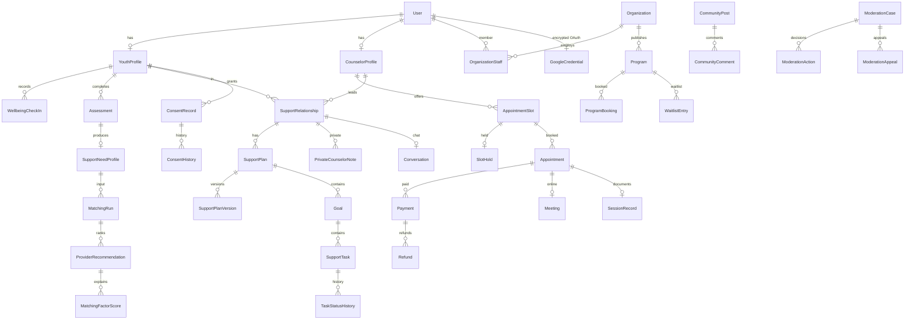

# Architecture

Sathi is a **modular monolith**: one repository, one PostgreSQL database, three runtime processes.

```
frontend     React 19 SPA (Vite, Tailwind v4, TanStack Query, React Router, Recharts, Socket.IO client)
backend/api     Express 5 REST API /api/v1 + Socket.IO (chat). Business modules under src/modules/*
backend/worker  BullMQ worker. Reuses backend/api/src/jobs/processor.ts so job rules live in one place
shared  Pure, unit-tested domain logic shared by API and web:
                 matching engine, refund policy, booking & meeting state machines, consent evaluation,
                 moderation classifier, progress "What changed?", Zod schemas
backend/prisma/   schema.prisma, migrations (incl. hand-written integrity constraints), seed
```

## Request flow



## Modules (backend/api/src/modules)

| Module | Responsibility |
|---|---|
| auth | Register, login, logout, email verification, password reset/change, refresh rotation with reuse detection |
| users | Account, profiles (youth/counselor/organization), verification documents (magic-byte validated), staff, data export, account deletion |
| assessments | Configurable question bank, save/resume wizard, Support Need Profile (versioned), safety pathway (independent of matching) |
| matching | Hard filters + weighted explainable scoring (shared), persisted runs and factor scores, versioned weights |
| consents | Granular per-category consent with history; access log transparency |
| counselors | Directory, availability, exceptions, timezone-correct slot generation |
| appointments | 10-min holds, booking (compare-and-set + partial unique index), decisions, cancel/reschedule, outcomes, session records |
| payments | Gateway abstraction (eSewa v2, Khalti ePayment v2), server-side verification, idempotent settlement, refunds |
| meetings | Google OAuth (encrypted refresh tokens), provider abstraction, idempotent Meet creation via Calendar API, retry/cancel/reschedule |
| support | Relationships, private notes, plans (versioned), goals, tasks (+history), reviews, milestones, timeline, consent-gated progress |
| programs | Organization programs/services, admin approval, capacity-safe booking, waitlist promotion, attendance, feedback, recommendations |
| community | Posts/comments/replies/reactions, reports, blocks, appeals, layered moderation engine |
| admin | Analytics (aggregates), users, verification, approvals, moderation workspace, settings, assessment config, payments/refunds, audit, jobs |
| misc | Notifications, resource library, chat REST |

## Independent state machines
Appointment status, payment status and meeting status are stored and transitioned **separately**
(`shared/src/booking.ts`, `meeting.ts`, `PaymentStatus`). A payment can succeed while an appointment
has already expired (→ automatic refund request); a meeting can fail while the appointment stays CONFIRMED.

## Data model (ER overview)



Full schema: `backend/prisma/schema.prisma`. Integrity constraints added in SQL migration `20261121180000_moderation_meetings`:
- `Appointment_active_slot_key` — partial unique index: at most one active appointment per slot.
- `Program_seats_check` — `0 <= seatsTaken <= seats`.

All timestamps are UTC (`timestamptz` semantics via Prisma `DateTime`); money is integer paisa.
